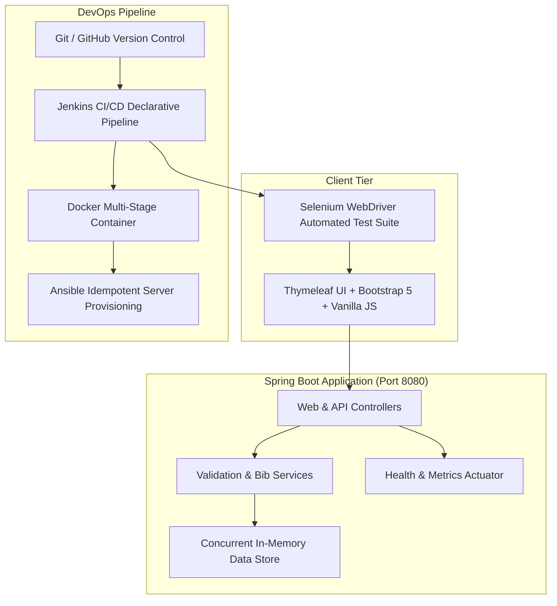

# Marathon Registration Portal — DevOps Pipeline

[]()
[](https://bell-sw.com/)
[](https://spring.io/projects/spring-boot)
[](https://www.jenkins.io/)
[](https://www.selenium.dev/)
[](https://www.docker.com/)
[](https://www.ansible.com/)
[]()

> A robust, containerized, and automated web portal for marathon runner registrations, equipped with an end-to-end DevOps pipeline incorporating Git branching, Jenkins CI/CD, Selenium automated UI regression testing, Docker containerization, and idempotent Ansible server provisioning.

---

## 📌 Repository Information
- **Remote Repository URL:** [https://github.com/Anish-Nadar/devops-finalyr.git](https://github.com/Anish-Nadar/devops-finalyr.git)
- **Primary Branches:** `main` (Production Releases), `develop` (Integration Baseline)

---

## 🚀 Key Features

1. **Multi-Category Runner Registration:**
   - Full Marathon (42.195 km)
   - Half Marathon (21.0975 km)
   - 10K Challenge (10 km)
   - 5K Fun Run (5 km)
2. **Dual-Layer Validation Engine:**
   - Client-side HTML5/JavaScript immediate field feedback.
   - Server-side Spring Bean Validation enforcing category age limits (FM: 18+, HM: 16+, 10K: 14+, 5K: 10+), email uniqueness, and emergency contact formats.
3. **Atomic Unique ID & Bib Number Generator:**
   - Immediate generation of human-readable Registration IDs (e.g., `REG-FM-B4C2`).
   - Atomic allocation of unique race Bib numbers upon admin approval (e.g., `BIB-FM-1001`).
4. **Real-Time Registration Status Tracking:**
   - Instant search by Registration ID or Email address.
   - Visual status badges (`PENDING_APPROVAL`, `APPROVED`, `REJECTED`) and event details.
5. **Admin Management Dashboard:**
   - Live category quota utilization bars.
   - Filterable participant roster.
   - One-click approval and rejection workflow.
6. **DevOps Health Check Endpoint:**
   - `/health` endpoint returning system uptime, status, and memory metrics for container and load-balancer probes.

---

## 🏗 System Architecture



---

## 🌿 Git Branching & Contribution Policy

This repository adheres to a strict GitFlow branching standard:

| Branch Pattern | Source | Target | Purpose |
| :--- | :--- | :--- | :--- |
| `main` | Tagged Release | None | Production-ready stable release baseline. |
| `develop` | `main` | `main` | Integration branch for ongoing feature development. |
| `feature/<name>` | `develop` | `develop` | New functionality development (e.g., `feature/registration-form`). |
| `bugfix/<name>` | `develop` | `develop` | Defect fixes during testing iterations. |
| `hotfix/<name>` | `main` | `main`, `develop` | Urgent production fixes. |

### Commit Message Conventions
All commit messages must follow the Conventional Commits specification:
- `feat:` A new user-facing feature.
- `fix:` A bug fix.
- `docs:` Documentation only changes.
- `ci:` Changes to CI/CD configuration (Jenkinsfile, Docker, Ansible).
- `test:` Adding or updating tests (JUnit, Selenium).
- `refactor:` Code change that neither fixes a bug nor adds a feature.

---

## 🛠 Local Setup & Execution

### Prerequisites
- Java OpenJDK 21 LTS
- Maven 3.9+ (or use the included `mvnw.cmd` / `mvnw`)
- Docker Desktop 29+ (optional for container execution)

### 1. Clone the Repository
```bash
git clone https://github.com/Anish-Nadar/devops-finalyr.git
cd devops-finalyr
```

### 2. Build the Application
```bash
# On Windows
.\mvnw.cmd clean compile

# On Linux/macOS
./mvnw clean compile
```

### 3. Run the Application Locally
```bash
# On Windows
.\mvnw.cmd spring-boot:run

# On Linux/macOS
./mvnw spring-boot:run
```
The application will be live at: **`http://localhost:8080`**

---

## 🧪 Testing Suite

### Run Unit Tests
```bash
.\mvnw.cmd test
```

### Run Selenium Automated UI Tests
```bash
.\mvnw.cmd test -Dtest=RegistrationSeleniumTest
```

---

## 🐳 Docker Containerization

### Build Image
```bash
docker build -t marathon-portal:1.0.0 .
```

### Run Container
```bash
docker run -d -p 8080:8080 --name marathon-portal-app marathon-portal:1.0.0
```

---

## ⚙️ Configuration Management (Ansible)
Server provisioning, user creation, firewall rules, and container deployment are automated via Ansible:
```bash
ansible-playbook -i ansible/inventory.ini ansible/deploy.yml
```

---

## 📄 License
This project is licensed under the MIT License — see the LICENSE file for details.

