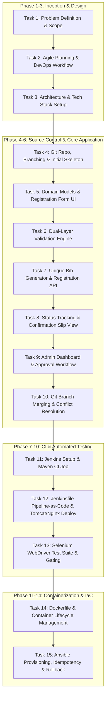

# Phase 1: Problem Definition and Scope
## Marathon Registration Portal — DevOps Pipeline Project

---

### 1. Executive Summary & Real-Time Need
Major marathon and endurance running events (e.g., City Marathon, Metro Half-Marathon) face extreme operational challenges during registration periods. Registration launches often trigger sudden, intense spikes in web traffic that overwhelm legacy or un-automated registration platforms. 

**Real-world Operational Problems:**
- **System Outages During Peak Surges:** Servers crash under concurrency spikes when registration opens, leaving runners frustrated and event organizers with corrupted transaction data.
- **Manual Data Processing & Duplicate Records:** Lack of real-time validation and automated unique bib assignment leads to duplicate bib numbers, mismatched race categories, and incomplete emergency contact details.
- **Uncertainty & Lack of Transparency:** Participants often do not receive immediate confirmation or real-time status updates (e.g., Pending, Approved, Waitlisted, Confirmed).
- **Inflexible, Fragile Release Cycles:** Event organizers face bugs and deployment delays because changes are pushed manually without automated testing, containerization, or standardized server configurations.

To solve this, the **Marathon Registration Portal** provides a modern, resilient web portal backed by an automated end-to-end **DevOps Pipeline** (incorporating Git branching, Jenkins CI/CD, Selenium automated UI testing, Docker containerization, and Ansible configuration management).

---

### 2. Target Users & Personas

| User Persona | Role | Key Needs & Expectations |
| :--- | :--- | :--- |
| **Alex Rivera (Participant / Runner)** | End-User | Fast, intuitive registration across race categories (Full Marathon 42.195 km, Half Marathon 21.0975 km, 10K, 5K); instant validation; immediate status confirmation; downloadable registration slip with bib ID. |
| **Elena Rostova (Race Director / Admin)** | Event Organizer | Real-time participant roster; capacity monitoring per category; ability to review, approve, or reject registrations; medical declaration visibility. |
| **Dr. Sanjay Patel (Medical Coordinator)** | Emergency Services | Instant, reliable access to participant emergency contact information and declared medical conditions. |
| **Marcus Vance (Lead DevOps Engineer)** | Infrastructure & Operations | Standardized containerized build, zero-touch continuous integration, automated regression testing before deployment, reproducible environments, zero-downtime rolling updates, and rapid rollback mechanisms. |

---

### 3. Existing Pain Points vs. Proposed Solution

| Existing Pain Point | Root Cause | Proposed DevOps & Architecture Solution |
| :--- | :--- | :--- |
| Portal crashes during registration rush | Monolithic, untuned deployment with manual configuration | Containerized microservice/modular architecture with Docker, deployable behind reverse proxy or orchestration. |
| High bug rate on production release | Lack of pre-deployment automated tests | Selenium WebDriver test suite integrated into Jenkins CI pipeline with automated deployment gating. |
| "Works on my machine" deployment friction | Inconsistent dev, test, and production environments | Docker images packaging all runtime dependencies and Ansible playbooks automating server configuration. |
| Slow recovery from failed releases | Manual server backups and ad-hoc patch scripts | Automated rollback strategy parameterized in Jenkins and Ansible playbooks with automated health-check verification. |
| Incomplete participant data and duplicate bibs | Client-only or manual spreadsheet checks | Robust dual-layer (client + server) validation engine and atomic unique bib code generation. |

---

### 4. Stakeholder Register & RACI Matrix

- **R** = Responsible (does the work)
- **A** = Accountable (final decision maker & approver)
- **C** = Consulted (provides input/feedback)
- **I** = Informed (kept updated)

| Project Phase / Deliverable | Event Director | Lead DevOps | Full-Stack Dev | QA Engineer | Participants |
| :--- | :---: | :---: | :---: | :---: | :---: |
| Problem Scope & Objectives | **A** | **C** | **C** | **C** | **I** |
| Architecture & Tech Stack | **I** | **A** | **R** | **C** | **I** |
| Feature Development & Code Quality | **I** | **C** | **R/A** | **C** | **I** |
| Automated CI/CD Pipeline (Jenkins) | **I** | **R/A** | **C** | **C** | **I** |
| Automated Testing Suite (Selenium) | **I** | **C** | **C** | **R/A** | **I** |
| Containerization & Registry (Docker) | **I** | **R/A** | **C** | **I** | **I** |
| Server Provisioning & Rollback (Ansible) | **I** | **R/A** | **I** | **I** | **I** |
| Final Acceptance & Go-Live | **A** | **R** | **R** | **R** | **I** |

---

### 5. Project Constraints

1. **Technical Constraints:**
   - Platform must run on standard JDK 21 LTS with Maven build automation.
   - Continuous Integration must be driven by Jenkins (`Jenkinsfile` Pipeline-as-Code).
   - Automated testing must utilize Selenium WebDriver with headless Chrome execution.
   - Application packaging must be containerized via Docker and deployable to Tomcat/Nginx or standalone container runtimes.
   - Server automation and idempotency must be governed by Ansible playbooks.
2. **Operational Constraints:**
   - Zero data loss during registration spikes.
   - Development and CI/CD must be executable locally and in standard virtualized/cloud environments.
3. **Security & Regulatory Constraints:**
   - Strict sanitization on all user inputs to protect against Cross-Site Scripting (XSS) and injection attacks.
   - Safe handling of emergency medical data and participant PII.

---

### 6. Measurable Success Criteria & KPIs

| Metric Category | Key Performance Indicator (KPI) | Target Benchmark |
| :--- | :--- | :--- |
| **Registration Performance** | Average registration submission response time | `< 1.5 seconds` under standard load |
| **Validation Accuracy** | Invalid input rejection & duplicate bib prevention | `100%` accuracy |
| **CI Build Duration** | Clean checkout, compile, package, and unit test in Jenkins | `< 3 minutes` |
| **Automated Test Coverage** | Critical user journey coverage via Selenium | `100%` of primary MVP journeys (Happy path, validation errors, admin approval) |
| **Deployment Speed** | Commit-to-Containerized Deployment pipeline | `< 5 minutes` end-to-end |
| **Configuration Idempotency** | Ansible playbook execution variance | `0 failed tasks` on clean run, `0 changed tasks` on re-run |
| **Rollback Capability** | Mean time to recover (MTTR) upon failed health check | `< 60 seconds` automated rollback |

---

### 7. Frozen 15-Task MVP Scope

To ensure a disciplined, phased execution, the MVP scope is strictly frozen into 15 cohesive tasks:

#### Detailed Breakdown of the 15 Tasks:

1. **Task 1: Problem Definition and Scope (Current Step)**
   - Formulate problem statement, real-time demand analysis, target personas, stakeholder matrix, constraints, measurable KPIs, and freeze the 15-task scope.
2. **Task 2: Agile Planning & DevOps Workflow Definition**
   - Author user stories with Gherkin acceptance criteria, sprint backlog, Definition of Done (DoD), and complete DevOps lifecycle diagram.
3. **Task 3: System Architecture, SRS Summary & Technology Stack Setup**
   - Formulate Software Requirements Specification (SRS), application component architecture, REST API specification, and data models.
4. **Task 4: Git Repository Initialization & Branching Strategy**
   - Initialize Git repository, configure `.gitignore`, `README.md`, issue templates, branch policies (`main`, `develop`, `feature/*`), and commit initial skeleton.
5. **Task 5: Core Domain Models & Registration UI Development**
   - Develop responsive marathon registration UI (Full Marathon, Half Marathon, 10K, 5K categories, personal info, emergency contacts).
6. **Task 6: Dual-Layer Input Validation Engine**
   - Implement client-side and server-side validation (age restrictions per race category, email format, emergency phone format, medical declaration).
7. **Task 7: Registration Submission API & Bib Generator**
   - Implement REST endpoints for registration processing, generating unique bib identifiers (`BIB-FM-XXXX`, `BIB-HM-XXXX`, etc.).
8. **Task 8: Participant Status Tracking & Confirmation View**
   - Build participant lookup screen by Registration ID/Email to check application status and download/view confirmation details.
9. **Task 9: Admin Management Dashboard & Approval Workflow**
   - Develop administrative portal to list all registrations, filter by category/status, approve/reject participants, and monitor category quotas.
10. **Task 10: Git Collaboration, Feature Branch Merging & Conflict Resolution**
    - Demonstrate multi-branch workflow, deliberate conflict generation, manual resolution, tagging (`v1.0.0-mvp`), and baseline freeze.
11. **Task 11: Jenkins Continuous Integration Setup**
    - Configure Jenkins build job, hook Git repository, trigger automated builds on commit/polling, and archive compiled artifacts (`.war`/`.jar`).
12. **Task 12: Jenkinsfile Pipeline-as-Code & Server Deployment**
    - Author declarative `Jenkinsfile` with Checkout, Build, Test, Package, and Deploy stages with parameterized environment target.
13. **Task 13: Selenium WebDriver Automated UI Testing Suite**
    - Develop automated browser test suite covering registration submission, validation error catching, and admin status updates; integrate test reports into Jenkins pipeline.
14. **Task 14: Docker Containerization & Image Lifecycle**
    - Author multi-stage `Dockerfile`, build optimized container image, map ports, test lifecycle commands (`run`, `stop`, `restart`, `logs`, `inspect`).
15. **Task 15: Ansible Configuration Management, Idempotent Provisioning & Rollback**
    - Write Ansible playbook/inventory to automate target server prerequisites (packages, users, directories, firewall/ports), verify idempotency, and execute health-check rollback.

---

### 8. Phase 1 Sign-Off & Approval
- **Status:** **COMPLETED & FROZEN**
- **Deliverables Produced:**
  1. Real-time problem statement and justification.
  2. Stakeholder register with RACI matrix.
  3. Clear operational and technical constraints.
  4. Quantifiable success metrics and KPIs.
  5. Formally frozen 15-Task MVP scope mapped to all 14 project plan steps.

