# Phase 2: Agile Planning and DevOps Workflow
## Marathon Registration Portal — DevOps Pipeline Project

---

### 1. User Stories and Gherkin Acceptance Criteria

#### **US-01: Participant Race Registration**
- **As a** prospective marathon runner,
- **I want to** select my race category (Full Marathon 42.195 km, Half Marathon 21.0975 km, 10K, or 5K Fun Run) and fill in my personal and emergency contact details,
- **So that** I can register for the marathon event online seamlessly.
- **Acceptance Criteria (Gherkin):**
  ```gherkin
  Scenario: Successful submission with valid details
    Given the runner is on the Marathon Registration form
    When they enter full name "Jordan Lee", email "jordan@example.com", age 28, emergency contact "+15551234567"
    And select category "Full Marathon (42.195 km)"
    And accept the medical & liability waiver
    And click "Submit Registration"
    Then the system generates a unique Registration ID (e.g., "REG-FM-XXXXXX")
    And displays a confirmation page with registration details and status "PENDING_APPROVAL".
  ```

---

#### **US-02: Form Input & Eligibility Validation**
- **As a** registration system validator,
- **I want to** enforce strict category eligibility rules and data format validation on both client and server sides,
- **So that** invalid submissions, underage entries for high-endurance races, and corrupted data are rejected before entering the database.
- **Acceptance Criteria (Gherkin):**
  ```gherkin
  Scenario: Underage participant attempting Full Marathon
    Given a participant is aged 16
    When they select "Full Marathon (42.195 km)" (minimum age required: 18)
    And submit the registration form
    Then the system blocks the submission
    And displays a validation error: "Participants must be at least 18 years old for Full Marathon."

  Scenario: Malformed email or invalid emergency contact number
    Given a participant enters email "invalid-email" and contact "abc"
    When they click "Submit Registration"
    Then the form highlights the erroneous fields in red with descriptive error messages.
  ```

---

#### **US-03: Real-Time Registration Status Tracking**
- **As a** registered participant,
- **I want to** enter my Registration ID or registered Email address,
- **So that** I can track my current status (Pending, Approved, Waitlisted, Rejected) and view my allocated Bib Number.
- **Acceptance Criteria (Gherkin):**
  ```gherkin
  Scenario: Tracking valid registration
    Given a registration exists with ID "REG-HM-102938" and status "APPROVED"
    When the participant searches with ID "REG-HM-102938"
    Then the status tracking card displays "Status: APPROVED"
    And displays assigned Bib Number "BIB-HM-0421" and event wave start time.

  Scenario: Participant not found
    When a user searches with a non-existent ID "REG-000000"
    Then the system displays an alert: "No registration found matching the provided details."
  ```

---

#### **US-04: Admin Participant Roster & Filtering**
- **As a** race coordinator / admin,
- **I want to** view a consolidated dashboard listing all participant registrations with filters for race category and status,
- **So that** I can monitor registration quotas and manage participant intake in real time.
- **Acceptance Criteria (Gherkin):**
  ```gherkin
  Scenario: Filtering registrations by category
    Given the admin is on the Admin Management Dashboard
    When the admin selects category filter "Half Marathon"
    Then the table refreshes instantly showing only Half Marathon participants
    And displays total count and quota utilization (e.g., "145 / 500 spots filled").
  ```

---

#### **US-05: Admin Approval and Status Mutation**
- **As a** race director,
- **I want to** review pending registrations and toggle their status to "Approved" or "Rejected" with automatic Bib generation upon approval,
- **So that** only qualified, approved runners are allocated race day bibs.
- **Acceptance Criteria (Gherkin):**
  ```gherkin
  Scenario: Approving a pending registration
    Given a participant registration is in "PENDING_APPROVAL" status
    When the admin clicks "Approve"
    Then the status updates to "APPROVED"
    And an atomic unique Bib Number (e.g., "BIB-FM-105") is assigned
    And a confirmation timestamp is recorded.
  ```

---

#### **US-06: Continuous Integration & Automated Regression Gate**
- **As a** DevOps engineer,
- **I want** every code commit pushed to the Git repository to trigger an automated Jenkins build with Maven compilation, unit tests, and Selenium browser automation tests,
- **So that** broken code or UI regression defects never reach deployment environments.
- **Acceptance Criteria (Gherkin):**
  ```gherkin
  Scenario: Commit triggers automated build and test
    Given a developer merges a feature branch into "develop"
    When Jenkins detects the change
    Then it triggers the multi-stage pipeline: Checkout -> Compile -> Test -> Package
    And if any Selenium test fails, the pipeline halts immediately, marks build FAILED, and suppresses deployment.
  ```

---

#### **US-07: Containerized Deployment & Rollback**
- **As an** operations engineer,
- **I want** the validated application packaged into a Docker container and deployed automatically via Ansible configuration playbooks,
- **So that** target servers are configured idempotently and can roll back within 60 seconds if health checks fail.
- **Acceptance Criteria (Gherkin):**
  ```gherkin
  Scenario: Automated zero-touch container deployment
    Given a green Jenkins build and packaged artifact
    When the deploy stage executes
    Then Docker builds and tags the image `marathon-portal:v1.0.0`
    And starts the container mapped to port 8080
    And verifies the `/actuator/health` or `/health` endpoint responds with HTTP 200 OK.
  ```

---

### 2. Product Backlog & MoSCoW Prioritization

| Backlog ID | Story Title | User Persona | MoSCoW Priority | Story Points | Target Sprint |
| :---: | :--- | :--- | :---: | :---: | :---: |
| **PB-01** | Participant Registration Form UI & Inputs | Runner | **Must Have** | 5 | Sprint 1 |
| **PB-02** | Client & Server Validation Engine | Runner / System | **Must Have** | 5 | Sprint 1 |
| **PB-03** | In-Memory / Relational Data Model & Repository | System | **Must Have** | 3 | Sprint 1 |
| **PB-04** | Unique Bib & Registration ID Generator | System | **Must Have** | 3 | Sprint 2 |
| **PB-05** | Participant Registration Status Tracker UI | Runner | **Must Have** | 3 | Sprint 2 |
| **PB-06** | Admin Dashboard & Participant Listing | Admin | **Must Have** | 5 | Sprint 2 |
| **PB-07** | Admin Approval/Rejection Workflow | Admin | **Must Have** | 5 | Sprint 2 |
| **PB-08** | Git Repository Initialization & Branching Policy | DevOps | **Must Have** | 2 | Sprint 1 |
| **PB-09** | Jenkins Pipeline-as-Code (`Jenkinsfile`) | DevOps | **Must Have** | 8 | Sprint 3 |
| **PB-10** | Selenium WebDriver End-to-End Test Suite | QA Engineer | **Must Have** | 8 | Sprint 3 |
| **PB-11** | Dockerfile & Container Lifecycle Scripts | DevOps | **Must Have** | 5 | Sprint 3 |
| **PB-12** | Ansible Server Configuration Playbook | DevOps | **Must Have** | 5 | Sprint 3 |
| **PB-13** | Automated Health Check & Rollback Automation | DevOps | **Should Have** | 5 | Sprint 3 |
| **PB-14** | Category Quota Live Progress Bars | Admin / Runner | **Should Have** | 3 | Sprint 2 |
| **PB-15** | Printable PDF / HTML Confirmation Slip | Runner | **Could Have** | 2 | Sprint 2 |

---

### 3. The 15-Task Sprint & Kanban Plan

The 15 MVP tasks are allocated across three targeted 1-week Sprints:

```
+--------------------------------------------------------------------------------------------------------------------+
|                                                  SPRINT ROADMAP                                                    |
+------------------------------------+------------------------------------+------------------------------------------+
|  SPRINT 1: Architecture & Core     |  SPRINT 2: Complete MVP & Collab   |  SPRINT 3: CI/CD, Testing & IaC          |
|  Goal: Foundation & Form Baseline  |  Goal: Status, Admin & Git Branch  |  Goal: Automated Quality & Deploy Gate   |
|                                    |                                    |                                          |
|  - Task 1: Problem & Scope         |  - Task 6: Bib Generator Engine    |  - Task 11: Jenkins CI Build Job         |
|  - Task 2: Agile Planning & DoD    |  - Task 7: Status Tracking View    |  - Task 12: Pipeline-as-Code Jenkinsfile |
|  - Task 3: Architecture & SRS      |  - Task 8: Admin Roster & Filters  |  - Task 13: Selenium UI Test Suite       |
|  - Task 4: Git Repo & Skeleton     |  - Task 9: Admin Approval Flow     |  - Task 14: Dockerfile & Container Mgmt  |
|  - Task 5: Registration Form & Val |  - Task 10: Git Merge & Conflict   |  - Task 15: Ansible IaC & Rollback       |
+------------------------------------+------------------------------------+------------------------------------------+
```

#### **Visual Kanban Board State (Sprint 1 Active)**

| Backlog (Pending) | In Progress (WIP: 3) | Testing / Verification (WIP: 2) | Done (Completed) |
| :--- | :--- | :--- | :--- |
| **Task 4:** Git Repo & Skeleton Setup | **Task 3:** Architecture & SRS Specs | **Task 2:** Agile Planning & DoD | **Task 1:** Problem Definition & Scope |
| **Task 5:** Registration UI Form | | | |
| **Task 6:** Validation Engine | | | |
| **Task 7:** Unique Bib Generator | | | |
| **Task 8:** Status Tracking View | | | |
| **Task 9:** Admin Dashboard | | | |
| **Task 10:** Git Branch Conflict Resolution | | | |
| **Task 11:** Jenkins CI Job | | | |
| **Task 12:** Jenkinsfile Pipeline | | | |
| **Task 13:** Selenium Test Suite | | | |
| **Task 14:** Docker Containerization | | | |
| **Task 15:** Ansible Provisioning | | | |

---

### 4. Definition of Done (DoD)

For any task, user story, or feature branch to be considered **Done** and approved for production release, the following strict criteria must be satisfied:

1. **Code & Functionality Standards:**
   - Code complies with Java naming conventions, Clean Code principles, and proper package structure.
   - Dual-layer validation (HTML5 + Java Bean Validation) is active for all user inputs.
   - Zero hardcoded environment credentials or URLs (externalized via `application.properties` or environment variables).
2. **Version Control & Branching:**
   - Feature worked on isolated branch `feature/<task-name>` branched from `develop`.
   - Meaningful Git commit messages adhering to Conventional Commits (`feat:`, `fix:`, `docs:`, `ci:`).
   - Peer code review completed with zero open blockers.
   - Pull request cleanly merged into `develop` / `main`.
3. **Automated Testing & Quality Gates:**
   - Unit tests pass with `100%` success rate.
   - Selenium WebDriver test suite passes against headless Chrome without flaky assertions.
   - Pre-deployment automated tests must stop the pipeline immediately on any assertion failure.
4. **CI/CD & Artifact Delivery:**
   - Jenkins pipeline executes green across all stages: `Checkout` $\to$ `Build` $\to$ `Test` $\to$ `Package` $\to$ `Docker Build` $\to$ `Deploy`.
   - Build artifact (`.war` or `.jar`) is archived and tagged.
   - Multi-stage Docker image builds cleanly with minimal footprint.
5. **Infrastructure & Operational Readiness:**
   - Ansible playbook provisions the target node with zero errors and idempotent execution (re-run yields `changed=0`).
   - Health-check endpoint `/health` returns HTTP 200 OK.
   - Automated rollback verified and tested.
   - Documentation and release notes updated.

---

### 5. Comprehensive DevOps Lifecycle Diagram

The complete end-to-end DevOps lifecycle from development to production monitoring is modeled below:

```mermaid
flowchart LR
    subgraph Plan_and_Develop["1. Plan & Code (Agile / Git)"]
        A["Product Backlog<br/>(15 MVP Tasks)"] --> B["Feature Branch<br/>(feature/registration)"]
        B --> C["Local Unit Testing<br/>(Maven Clean Test)"]
        C --> D["Git Push & Pull Request<br/>(PR to develop)"]
    end

    subgraph CI_Stage["2. Continuous Integration (Jenkins)"]
        D --> E{"Jenkins Webhook / Polling"}
        E --> F["Stage 1: Checkout SCM"]
        F --> G["Stage 2: Maven Compile & Package"]
        G --> H["Stage 3: Selenium WebDriver Tests"]
    end

    subgraph Gating_Stage["3. Quality Gate"]
        H -->|Tests Fail| I["Halt Pipeline<br/>Notify Developers"]
        H -->|Tests Pass| J["Archive Artifact (.war/.jar)"]
    end

    subgraph CD_Stage["4. Continuous Delivery & Container (Docker)"]
        J --> K["Stage 4: Build Docker Image<br/>(marathon-portal:v1.0.0)"]
        K --> L["Stage 5: Push to Registry / Local Daemon"]
    end

    subgraph Config_and_Deploy["5. Provision & Deploy (Ansible)"]
        L --> M["Ansible Playbook Run<br/>(Configure OS, Ports, Java, Container)"]
        M --> N["Run Container on Port 8080"]
        N --> O{"Automated Health Check<br/>(HTTP /health)"}
        O -->|HTTP 200 OK| P["Production Deployment Live!"]
        O -->|HTTP Non-200 / Error| Q["Automated Rollback to Previous Release"]
    end

    style A fill:#e1f5fe,stroke:#01579b,stroke-width:2px
    style D fill:#e8f5e9,stroke:#2e7d32,stroke-width:2px
    style H fill:#fff3e0,stroke:#e65100,stroke-width:2px
    style I fill:#ffebee,stroke:#c62828,stroke-width:2px
    style P fill:#e8f8f5,stroke:#117a65,stroke-width:3px
    style Q fill:#fbeee6,stroke:#b03a2e,stroke-width:2px
```



---

### 6. Phase 2 Deliverable Summary
- **User Stories & Acceptance Criteria:** 7 complete user stories defined in Gherkin syntax covering all stakeholder requirements.
- **Product Backlog:** Prioritized 15 items with MoSCoW rankings, story points, and sprint allocations.
- **Sprint & Kanban Plan:** 3-sprint roadmap with visual WIP board.
- **Definition of Done (DoD):** 5-point quality checklist spanning code, tests, CI/CD, Docker, and Ansible.
- **DevOps Lifecycle Workflow:** Complete architecture diagram linking code push $\to$ Jenkins $\to$ Selenium $\to$ Docker $\to$ Ansible $\to$ Health-check Rollback.

