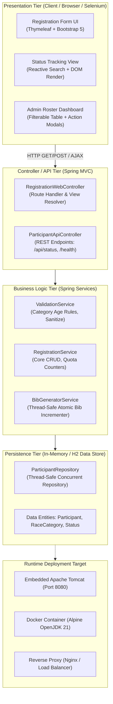

# Phase 3: Requirements, Architecture and Technology Setup
## Marathon Registration Portal — DevOps Pipeline Project

---

### 1. Software Requirements Specification (SRS) Summary

#### 1.1 Purpose & Scope
The Marathon Registration Portal is an enterprise-grade, high-performance web application designed for endurance sporting events. It provides an intuitive registration flow for runners and an administrative portal for event directors, while serving as the core target for an automated DevOps pipeline (Git, Jenkins, Selenium, Docker, Ansible).

#### 1.2 Functional Requirements (FR)
| ID | Requirement Name | Description | Priority |
| :--- | :--- | :--- | :---: |
| **FR-1** | Race Category Selection | User can select from: Full Marathon (42.195 km), Half Marathon (21.0975 km), 10K Run, 5K Fun Run. | High |
| **FR-2** | Runner Registration Form | Capture Full Name, Email, Age, Gender, Emergency Contact Name & Phone, and Medical Declaration. | High |
| **FR-3** | Dual-Layer Validation | Client-side (HTML5/JS) and server-side (Spring Validation) checks. Strict category age limits (FM: 18+, HM: 16+, 10K: 14+, 5K: 10+). | High |
| **FR-4** | Unique ID & Bib Allocation | System generates `REG-{CAT}-{HEX}` upon submission and allocates atomic `BIB-{CAT}-{NUM}` upon admin approval. | High |
| **FR-5** | Real-Time Status Tracking | Runners search by Registration ID or Email to see live status (`PENDING_APPROVAL`, `APPROVED`, `REJECTED`) and assigned Bib. | High |
| **FR-6** | Admin Participant Dashboard | Event coordinators can inspect registrations, search/filter by category/status, and view quota capacity bars. | High |
| **FR-7** | Admin Approval Workflow | One-click Approval (auto-allocating Bib) or Rejection with audit timestamp. | High |
| **FR-8** | Health Check & Metrics API | Lightweight `/health` endpoint returning system operational status (`UP`), memory usage, and uptime for DevOps probes. | High |

#### 1.3 Non-Functional Requirements (NFR)
- **NFR-1 (Performance):** Page render times `< 500ms`, form submission response `< 1500ms`.
- **NFR-2 (Reliability):** Thread-safe in-memory/H2 storage with zero data loss or concurrency race conditions during registration spikes.
- **NFR-3 (Security):** All inputs sanitized against XSS and SQLi; HTML entities escaped in Thymeleaf.
- **NFR-4 (Portability):** Packaged as a standalone executable JAR or WAR deployable on standard Embedded Tomcat, external Tomcat 10, or Docker.
- **NFR-5 (Testability):** Deterministic HTML identifiers (`id`, `data-testid`) across all DOM elements to guarantee reliable Selenium WebDriver testing.

---

### 2. UML Use-Case Diagram

```mermaid
usecaseDiagram
    actor "Participant / Runner" as Runner
    actor "Race Director / Admin" as Admin
    actor "DevOps / Monitoring" as DevOps

    package "Marathon Registration Portal" {
        usecase "View Race Categories & Details" as UC1
        usecase "Submit Registration Form" as UC2
        usecase "Validate Age & Medical Details" as UC3
        usecase "Receive Registration ID & Slip" as UC4
        usecase "Track Registration Status" as UC5
        usecase "View Participant Roster" as UC6
        usecase "Filter by Category & Status" as UC7
        usecase "Approve Registration & Assign Bib" as UC8
        usecase "Reject Registration" as UC9
        usecase "Monitor System Health (/health)" as UC10
    }

    Runner --> UC1
    Runner --> UC2
    Runner --> UC5
    UC2 ..> UC3 : <<include>>
    UC2 ..> UC4 : <<include>>

    Admin --> UC6
    Admin --> UC7
    Admin --> UC8
    Admin --> UC9

    DevOps --> UC10
```

---

### 3. Application Component Architecture Diagram

The portal is designed as a modular 3-tier Spring Boot architecture with clean separation of concerns:



---

### 4. Data Model Specifications

#### 4.1 `Participant` Entity
| Field Name | Data Type | Constraints / Rules | Description |
| :--- | :--- | :--- | :--- |
| `id` | `String` | Primary Key, UUID | Internal identifier |
| `registrationId` | `String` | Unique, Index | Public reference (e.g., `REG-FM-7A9B`) |
| `bibNumber` | `String` | Nullable, Unique | Assigned upon approval (e.g., `BIB-FM-1001`) |
| `fullName` | `String` | NotBlank, 2-100 chars | Runner full legal name |
| `email` | `String` | NotBlank, Valid Email | Runner primary email |
| `age` | `Integer` | Min: 10, Max: 99 | Runner age on race day |
| `gender` | `String` | Male, Female, Non-Binary | Runner gender category |
| `category` | `RaceCategory` | Enum (FM, HM, 10K, 5K) | Selected race event |
| `emergencyName` | `String` | NotBlank | Primary contact person |
| `emergencyPhone`| `String` | Regex Phone Pattern | Emergency contact phone number |
| `medicalDeclaration`| `String`| Optional | Allergies, medications, conditions |
| `waiverAccepted`| `Boolean`| Must be `true` | Legal liability & medical consent |
| `status` | `RegistrationStatus`| Enum (PENDING, APPROVED, REJECTED) | Current approval state |
| `createdAt` | `LocalDateTime` | Auto-generated timestamp | Submission date & time |
| `updatedAt` | `LocalDateTime` | Auto-updated timestamp | Last status mutation timestamp |

#### 4.2 Enumerations
- **`RaceCategory`:**
  - `FULL_MARATHON` ("Full Marathon - 42.195 km", Min Age: 18, Bib Prefix: "BIB-FM-")
  - `HALF_MARATHON` ("Half Marathon - 21.0975 km", Min Age: 16, Bib Prefix: "BIB-HM-")
  - `TEN_K` ("10K Challenge - 10 km", Min Age: 14, Bib Prefix: "BIB-10K-")
  - `FIVE_K` ("5K Fun Run - 5 km", Min Age: 10, Bib Prefix: "BIB-5K-")
- **`RegistrationStatus`:**
  - `PENDING_APPROVAL` (Initial submission state)
  - `APPROVED` (Approved by race director, Bib assigned)
  - `REJECTED` (Disqualified or duplicate registration)

---

### 5. REST & Web API Endpoints

| HTTP Method | Route / Endpoint | Request Payload / Params | Response | Description |
| :---: | :--- | :--- | :--- | :--- |
| `GET` | `/` | None | HTML | Displays participant registration form |
| `POST` | `/register` | Form fields (`ParticipantDTO`) | Redirect to `/confirmation/{id}` or HTML Form with Errors | Validates and persists new registration |
| `GET` | `/confirmation/{id}`| Path: `id` | HTML | Shows confirmed submission slip & Registration ID |
| `GET` | `/status` | None | HTML | Status tracking lookup page |
| `GET` | `/api/status` | Query: `?query={emailOrId}` | JSON `{status, bibNumber, ...}` | AJAX lookup endpoint for live tracking |
| `GET` | `/admin` | Query: `?category=...&status=...` | HTML | Admin management dashboard with participant table |
| `POST` | `/admin/approve/{id}`| Path: `id` | Redirect to `/admin` | Approves participant and generates Bib number |
| `POST` | `/admin/reject/{id}` | Path: `id` | Redirect to `/admin` | Rejects participant |
| `GET` | `/health` | None | JSON `{"status":"UP", "uptime":...}` | System health probe for DevOps / Jenkins / Docker |

---

### 6. Technology Stack Selection

| Component | Selected Technology | Version | Justification |
| :--- | :--- | :--- | :--- |
| **Language & Platform** | Java OpenJDK (Liberica) | **21 LTS** | Modern LTS release, high performance, robust concurrency |
| **Application Framework** | Spring Boot | **3.2.x / 3.x** | Industry standard, embedded Tomcat server, production-ready metrics |
| **Build Automation** | Apache Maven | **3.9.x** | Declarative lifecycle (`compile`, `test`, `package`), native Jenkins integration |
| **Template Engine** | Thymeleaf + Bootstrap 5 | **5.3.x** | Clean server-side rendering, responsive mobile-first UI |
| **Data Persistence** | In-Memory / Concurrent Repository | **Java Concurrent** | Zero-external-dependency bootstrapping, high concurrency safety |
| **Application Server** | Embedded Apache Tomcat | **10.1.x** | Out-of-the-box self-contained fat JAR deployment |
| **Automated Testing** | JUnit 5 + Selenium WebDriver | **4.x** | Multi-browser headless automation matching real user journeys |
| **CI/CD Orchestration** | Jenkins | **LTS** | Declarative Pipeline-as-Code (`Jenkinsfile`) |
| **Containerization** | Docker | **29.x** | Multi-stage lightweight container packaging |
| **Configuration Mgmt** | Ansible | **Core** | Agentless, declarative, idempotent server provisioning |

