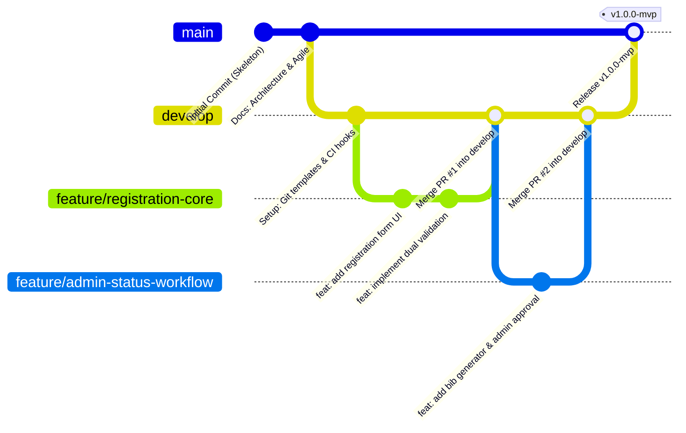

# Phase 4: Git and GitHub Repository Initialization
## Marathon Registration Portal — DevOps Pipeline Project

---

### 1. Repository Specification
- **Remote Repository URL:** [https://github.com/Anish-Nadar/devops-finalyr.git](https://github.com/Anish-Nadar/devops-finalyr.git)
- **Primary Upstream:** `origin`
- **Default Baseline Branch:** `main`
- **Integration Branch:** `develop`

---

### 2. Git Configuration & Repository Layout
The repository is initialized with a clean, modular structure conforming to standard Java and DevOps conventions:

```
devops/
├── .github/
│   ├── ISSUE_TEMPLATE/
│   │   ├── bug_report.md
│   │   └── feature_request.md
│   └── pull_request_template.md
├── docs/
│   ├── 01_problem_definition_and_scope.md
│   ├── 02_agile_planning_and_devops_workflow.md
│   ├── 03_requirements_architecture_and_technology_setup.md
│   └── 04_git_and_github_repository_initialization.md
├── src/
│   ├── main/
│   │   ├── java/com/marathon/
│   │   │   └── MarathonApplication.java
│   │   └── resources/
│   │       └── application.properties
│   └── test/
│       └── java/com/marathon/
│           └── MarathonApplicationTests.java
├── .gitignore
├── README.md
├── mvnw
├── mvnw.cmd
├── pom.xml
└── project plan.txt
```

---

### 3. Branching & Governance Policy



#### Naming Conventions:
- **Feature Branches:** `feature/<kebab-case-description>` (e.g., `feature/registration-form`, `feature/status-tracker`)
- **Bug Fix Branches:** `bugfix/<kebab-case-description>` (e.g., `bugfix/age-validation-error`)
- **Release Branches:** `release/v<version>` (e.g., `release/v1.0.0`)
- **Tags:** Semantic versioning `v<major>.<minor>.<patch>` (e.g., `v1.0.0-mvp`)

---

### 4. Git Initialization Commands Executed
1. `git init -b main`
2. `git config user.name "Anish Nadar"`
3. `git config user.email "anish.nadar@example.com"`
4. `git remote add origin https://github.com/Anish-Nadar/devops-finalyr.git`
5. `git add .`
6. `git commit -m "feat: initial project skeleton with Maven, Spring Boot, and DevOps documentation"`
7. `git checkout -b develop`
