# Phase 8: Pipeline as Code and Server Deployment
## Marathon Registration Portal — DevOps Pipeline Project

---

### 1. Declarative Jenkinsfile (Pipeline-as-Code)
The continuous delivery pipeline is codified via a root-level declarative [`Jenkinsfile`](file:///C:/Users/Admin/Desktop/Projects/devops/Jenkinsfile). It defines 5 distinct stages and externalizes deployment configurations as pipeline parameters:

#### Parameters Defined:
- `DEPLOY_ENV` (Choice: `staging`, `production`, `local` — Default: `staging`)
- `SERVER_PORT` (String: Default: `8080`)
- `AUTO_DEPLOY` (Boolean: Default: `true`)

```mermaid
flowchart LR
    A["Stage 1: Checkout SCM<br/>(Git clone develop)"] --> B["Stage 2: Compile & Verify<br/>(mvn compile)"]
    B --> C["Stage 3: Run Tests<br/>(mvn test)"]
    C --> D["Stage 4: Package JAR<br/>(mvn package)"]
    D --> E["Stage 5: Deploy to Tomcat<br/>(Port 8080, Staging)"]
    E --> F["Automated Health Probe<br/>(GET /health -> HTTP 200)"]

    style A fill:#e3f2fd,stroke:#1565c0,stroke-width:2px
    style C fill:#fff3e0,stroke:#e65100,stroke-width:2px
    style D fill:#e8f5e9,stroke:#2e7d32,stroke-width:2px
    style E fill:#f3e5f5,stroke:#7b1fa2,stroke-width:2px
    style F fill:#e8f8f5,stroke:#117a65,stroke-width:3px
```



---

### 2. Multi-Stage Pipeline Execution

| Stage Name | Command Executed | Expected Output / Artifact | Status |
| :--- | :--- | :--- | :---: |
| **Checkout SCM** | Git checkout revision from `origin/develop` | Working copy synced | **SUCCESS** |
| **Compile & Verify** | `.\mvnw.cmd clean compile` | 12 classes compiled to `target/classes` | **SUCCESS** |
| **Execute Tests** | `.\mvnw.cmd test` | JUnit 5 unit test execution (`1 pass, 0 fail`) | **SUCCESS** |
| **Package JAR** | `.\mvnw.cmd package -DskipTests=true` | Standalone executable fat JAR (25.4 MB) | **SUCCESS** |
| **Deploy to Server** | Embedded Tomcat on Port 8080 | Live HTTP listener on `:8080` | **SUCCESS** |

---

### 3. Server Deployment & Health Verification Evidence

The deployed application was launched and probed across multiple routes:

#### Health Probe Verification (`GET http://localhost:8080/health`):
```json
HTTP Status: 200 OK
{
    "status": "UP",
    "service": "marathon-registration-portal",
    "version": "1.0.0-mvp",
    "totalRegistrations": 3,
    "memoryTotalBytes": 47185920,
    "memoryFreeBytes": 15703488,
    "systemTimestamp": "2026-11-02T21:36:10.543309100"
}
```

#### Status API Verification (`GET http://localhost:8080/api/status?query=REG-FM-101A`):
```json
HTTP Status: 200 OK
{
    "found": true,
    "registrationId": "REG-FM-101A",
    "fullName": "Alex Rivera",
    "category": "Full Marathon",
    "statusLabel": "Pending Approval",
    "status": "PENDING_APPROVAL",
    "bibNumber": null
}
```

#### Web Presentation Verification:
- **Registration Form:** `http://localhost:8080/` (HTTP 200 OK, 12,263 bytes rendered)
- **Status Tracker:** `http://localhost:8080/status` (HTTP 200 OK)
- **Admin Dashboard:** `http://localhost:8080/admin` (HTTP 200 OK)

---

### 4. Configuration Evidence
- Pipeline definition: [Jenkinsfile](file:///C:/Users/Admin/Desktop/Projects/devops/Jenkinsfile)
- Automated verification script: [scripts/test_deployment.ps1](file:///C:/Users/Admin/Desktop/Projects/devops/scripts/test_deployment.ps1)
- Pipeline Job XML: `C:\ProgramData\Jenkins\.jenkins\jobs\marathon-portal-pipeline\config.xml`
